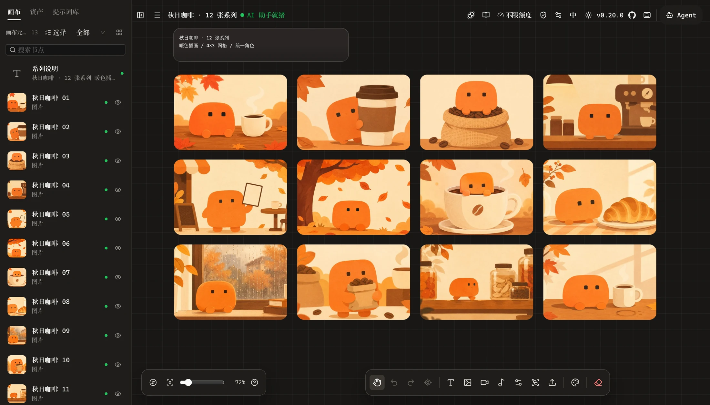
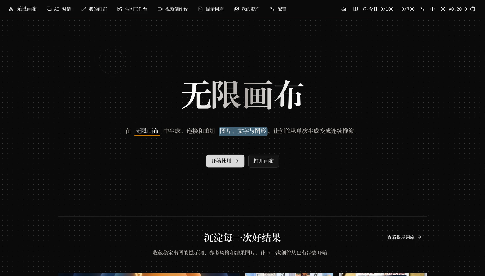
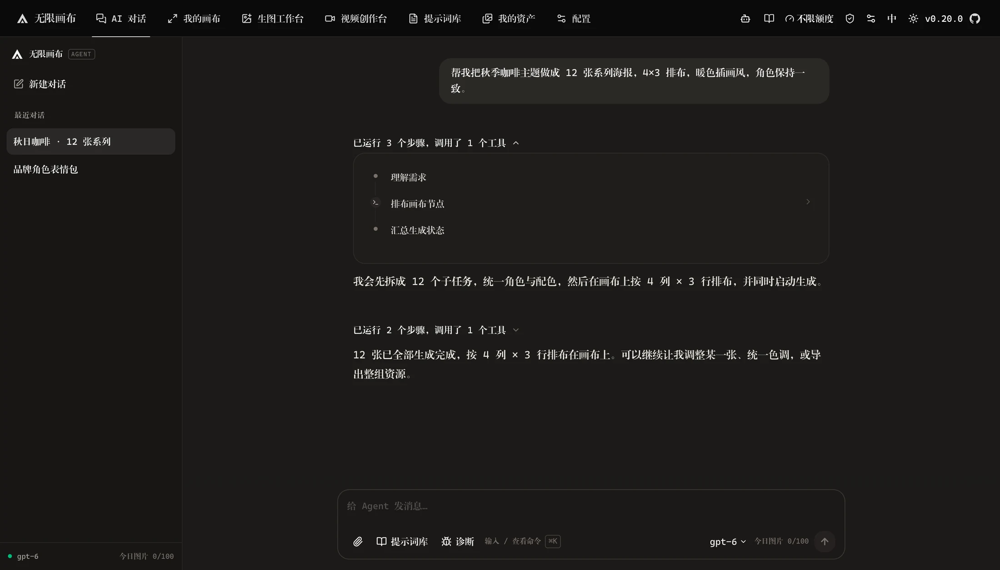
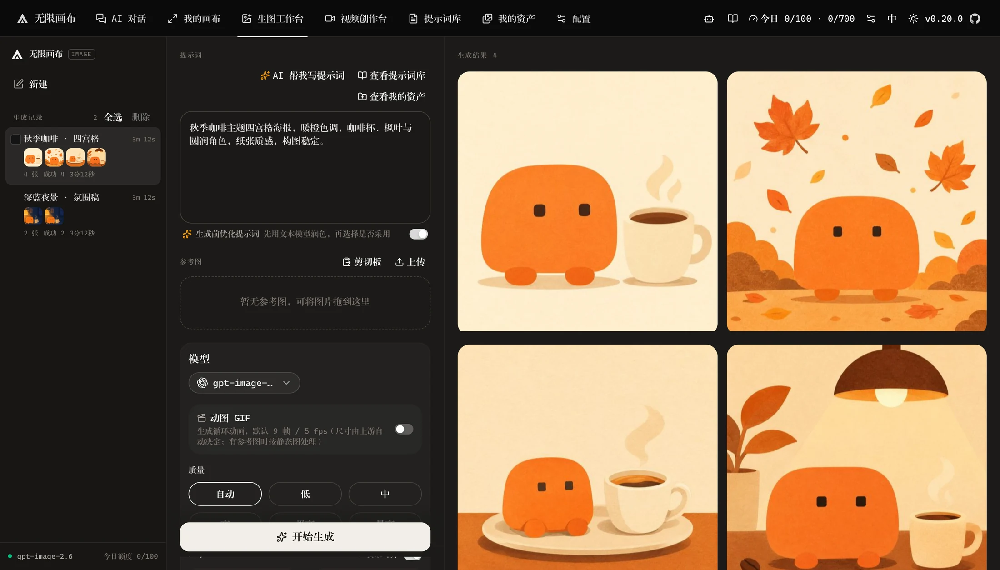
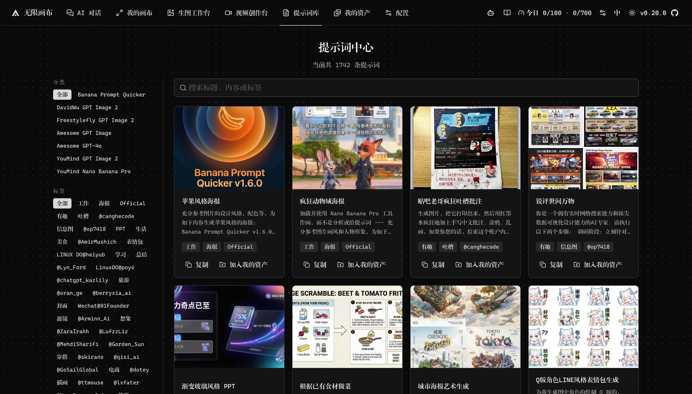
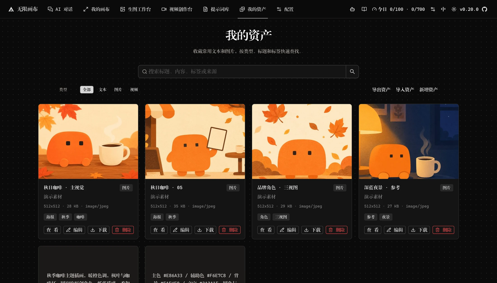
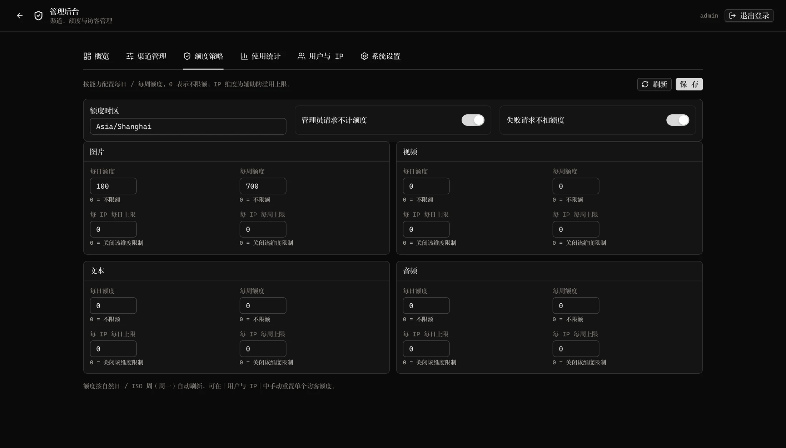
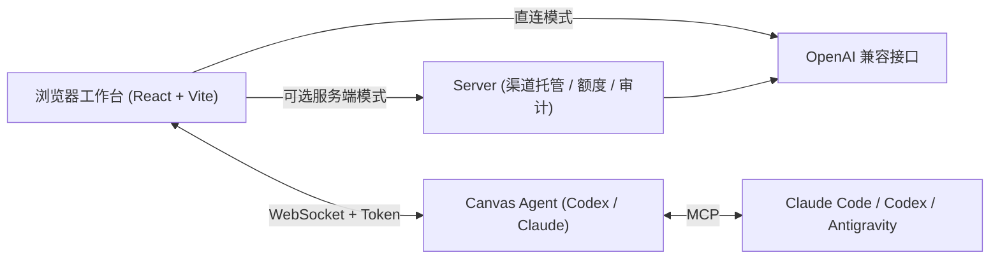

<p align="center">
  
</p>

<h1 align="center">无限画布 · Infinite Canvas</h1>

<p align="center">
  浏览器端的 AI 创作工作台：生成、连接、重组，让创作从一次生成变成连续推演。
</p>

<p align="center">
  
  
  
  
  
</p>

> **二次开发声明**：本仓库是 [basketikun/infinite-canvas](https://github.com/basketikun/infinite-canvas) 的二次开发项目，不是官方仓库，也不代表上游或其维护者。原始代码与设计版权归原作者所有，遵循 [MIT License](LICENSE)。二开说明见 [NOTICE.md](NOTICE.md)，本地变更见 [LOCAL-UPDATES.md](LOCAL-UPDATES.md)。当前基线为上游 `v0.20.0`，仍处于开发阶段。

## 项目介绍

无限画布把「提示词 → 生成 → 排布 → 复用」放在同一块可无限平移、缩放的画布上。文本、图片、视频、音频与生成配置都是可继续编辑的节点，可以连线组成可追溯、可复用的创作流程。

AI 请求由浏览器直接发往你配置的 OpenAI 兼容接口，画布、资产与生成记录默认保存在本机浏览器；也可以部署可选的服务端模式，统一托管渠道、额度与管理后台。

<p align="center">
  
  <br>
  <sub>无限画布 · 系列海报网格排布，左侧元素面板可检索、定位与显隐</sub>
</p>

## 核心功能与界面预览

- **画布工作流**：文本、图片、视频、音频、生成配置与分组节点，连线传递提示词与参考图，结果保留参数，可重试与二次编辑。
- **AI 生成**：多渠道 OpenAI 兼容接口，图片张数、比例、参考图、透明背景与自定义调用脚本；任务排队、自动重试、刷新后恢复。
- **AI 对话与画布助手**：一句话拆成多步，自主调用工具完成生成、改图与画布排布，过程可见。
- **本地 Agent（Codex / Claude）**：画布右上角的 Agent 面板可在 Codex 与 Claude 之间切换，支持流式对话、会话历史与搜索、Skill、权限审批、文件改动 diff 与断线自动重连。
- **画布 MCP**：Claude Code、Codex、Antigravity 等本地 AI 工具可通过 `infinite-canvas` MCP 直接读取和操作当前画布。
- **提示词与素材**：聚合多个提示词源，支持搜索与插入画布；「我的资产」统一收藏图片、视频与文本。
- **服务端模式（可选）**：集中配置渠道与默认模型，按能力设置每日 / 每周 / 每 IP 额度，提供管理后台与审计。
- **同步与插件**：WebDAV 同步画布与资产；画布插件可扩展节点类型、渲染与工具栏动作。

完整功能说明见 [features.mdx](docs/content/docs/overview/features.mdx)。

### 功能模块展示

<table>
  <tr>
    <td width="50%" align="center">
      
      <br />
      <sub><b>首页工作台</b> · 统一入口、今日额度与提示词精选</sub>
    </td>
    <td width="50%" align="center">
      
      <br />
      <sub><b>AI 对话助手</b> · 拆解多步任务并自动调用工具排布画布</sub>
    </td>
  </tr>
  <tr>
    <td width="50%" align="center">
      
      <br />
      <sub><b>生图工作台</b> · 提示词润色、参考图、批量出图与参数记录</sub>
    </td>
    <td width="50%" align="center">
      
      <br />
      <sub><b>提示词库</b> · 多源聚合、标签检索、一键复制与加入资产</sub>
    </td>
  </tr>
  <tr>
    <td width="50%" align="center">
      
      <br />
      <sub><b>我的资产</b> · 统一收藏图片/文本/视频，支持标签筛选与导入导出</sub>
    </td>
    <td width="50%" align="center">
      
      <br />
      <sub><b>服务端管理后台</b> · 渠道托管、按能力与 IP 的额度策略配置</sub>
    </td>
  </tr>
</table>

### 整体架构



## 快速开始

环境要求：Bun 1.x；可选 Docker 24+；Node.js 18+（使用本地 Agent 时）。

### 本地开发

```bash
git clone https://github.com/NanQiaoMi/infinite-canvas.git
cd infinite-canvas/web
bun install
bun run dev
```

打开 `http://localhost:3000`，在右上角「配置」中填写 `Base URL`、`API Key` 与模型名。

### 服务端模式（渠道 + 额度 + 管理后台）

```bash
cp .env.example .env   # 至少修改 ADMIN_USERNAME / ADMIN_PASSWORD
docker compose -f docker-compose.local.yml up -d --build
```

访问 `http://localhost:3002`，管理后台为 `/admin`。数据保存在 `./data`，请勿提交或公开暴露。

### 本地 Agent 与画布 MCP

1. 启动本仓库的 Canvas Agent（新版网页需要本仓库版本的 Agent）：

   ```bash
   cd canvas-agent
   npm install
   npm run dev
   ```

2. 在画布右上角打开 `Agent`，把终端里 Agent 打印的 `Local URL` 与 `Connect token` 两行粘贴到连接框即可连接；顶部可切换 Codex / Claude。使用 Claude 前需先在终端运行 `claude` 并执行 `/login`。
3. 让 Claude Code、Codex、Antigravity 直接操作画布：参考 [canvas-agent/README.md](canvas-agent/README.md) 注册 `infinite-canvas` MCP；Agent 运行且网页已连接时工具即可生效。

## 安全说明

- 浏览器直连模式下 API Key 保存在浏览器本地，并由前端直接请求所配置的接口，请只在可信设备和 HTTPS 环境下使用。
- 画布与资产保存在浏览器本地，暂未提供云同步账号体系，换设备可使用 WebDAV 同步。
- 管理后台请仅在内网或受保护的反向代理后开放；插件运行在页面上下文中，只安装可信来源的插件。

## 文档

- [AI 文档索引](docs/index.md) · [功能说明](docs/content/docs/overview/features.mdx)
- [待办](docs/content/docs/progress/todo.mdx) · [待验收](docs/content/docs/progress/pending-test.mdx)
- [更新日志](CHANGELOG.md) · [Canvas Agent 说明](canvas-agent/README.md)
- [二开说明](NOTICE.md) · [安全说明](SECURITY.md)

## 协议

本项目使用 [MIT License](LICENSE)。上游项目 `basketikun/infinite-canvas` 版权归 basketikun 及贡献者所有；本仓库二开部分由 NanQiaoMi 维护，上游名称、Logo 与品牌归原作者所有，本仓库不代表上游官方。
